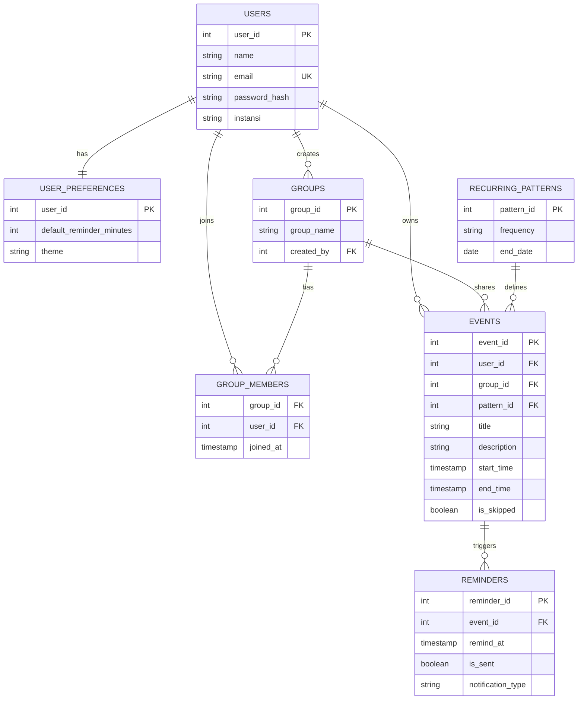

# SIMAJU REST API

> **Sistem Informasi Manajemen Jadwal Terpadu** — Layanan backend RESTful API untuk manajemen kalender kegiatan, agenda kolaboratif tim, perulangan acara berkala (*recurring events*), deteksi bentrok jadwal (*conflict detection*), dan pengingat otomatis (*reminders*).

Dibangun menggunakan arsitektur modern **Node.js**, **Express.js**, dan **PostgreSQL (Neon Serverless)**, serta siap di-deploy secara serverless ke **Vercel**.

- **Deployment URL**: [`https://simaju-backend.vercel.app`](https://simaju-backend.vercel.app)
- **Database**: PostgreSQL (Serverless via Neon / Supabase)
- **Runtime**: Node.js v18+

---

## Fitur Utama

- 📅 **Manajemen Jadwal Lengkap**: Operasi CRUD (Create, Read, Update, Delete) agenda kegiatan dengan validasi rentang waktu.
- ⚡ **Deteksi Bentrok Jadwal (Conflict Detection)**: Algoritma validasi otomatis untuk mencegah agenda tumpang tindih pada waktu yang sama.
- 🔁 **Perulangan Jadwal (Recurring Events)**: Konfigurasi pola perulangan (harian, mingguan, bulanan) dengan batas tanggal akhir.
- 👥 **Kolaborasi Agenda Grup**: Pembuatan ruang kerja tim, manajemen anggota (pivot many-to-many), dan pembagian agenda bersama.
- ⏰ **Sistem Pengingat (Reminders)**: Penjadwalan pengingat otomatis sebelum kegiatan dimulai beserta penanda status terkirim.

---

## Diagram Relasi Basis Data (ERD)

Basis data dirancang menggunakan relasi referensial antartabel PostgreSQL dengan integritas data dan batasan *Foreign Key*:



> **Catatan Skema**: Definisi skema basis data dalam format DBML tersedia pada file [`schema.dbml`](./schema.dbml).

---

## Struktur Tabel

1. **`users`**: Menyimpan data identitas pengguna (nama, email unik, kredensial terenkripsi, instansi).
2. **`user_preferences`**: Relasi One-to-One dengan `users` untuk menyimpan preferensi waktu pengingat dan tema aplikasi.
3. **`groups`**: Menyimpan daftar grup kolaborasi jadwal yang dibuat pengguna.
4. **`group_members`**: Tabel perantara (pivot Many-to-Many) antara pengguna dan grup.
5. **`recurring_patterns`**: Definisi pola frekuensi perulangan agenda dan tanggal berakhir.
6. **`events`**: Entitas utama penyimpanan seluruh jadwal kegiatan personal maupun grup.
7. **`reminders`**: Menyimpan data pengingat otomatis untuk setiap kegiatan.

---

## Dokumentasi Endpoint API

Base URL: `https://simaju-backend.vercel.app` (atau `http://localhost:3000` untuk lingkungan lokal).

### A. Health Check

#### Status Layanan
- **Method**       : `GET`
- **URL**          : `/`
- **Deskripsi**    : Memeriksa kesiapan server dan daftar endpoint aktif
- **Headers**      : *None*
- **Request Body** : *None*
- **Response Sukses (200)**:
  ```json
  {
    "success": true,
    "message": "SIMAJU (Sistem Informasi Manajemen Jadwal Terpadu) REST API is running successfully",
    "version": "1.0.0",
    "endpoints": {
      "users": "/api/users",
      "events": "/api/events",
      "groups": "/api/groups",
      "reminders": "/api/reminders"
    },
    "timestamp": "2026-10-25T12:00:00.000Z"
  }
  ```

---

### B. Pengguna & Autentikasi (`/api/users`)

#### 1. Registrasi Pengguna
- **Method**       : `POST`
- **URL**          : `/api/users/register`
- **Deskripsi**    : Mendaftarkan akun pengguna baru sekaligus menginisialisasi record preferensi bawaan
- **Headers**      : `Content-Type: application/json`
- **Request Body** :
  ```json
  {
    "name": "Alex Pratama",
    "email": "alex.pratama@simaju.app",
    "password": "PasswordAman123!",
    "instansi": "Divisi Teknologi Informasi",
    "default_reminder_minutes": 15,
    "theme": "dark"
  }
  ```
- **Response Sukses (201)**:
  ```json
  {
    "message": "Registrasi pengguna berhasil",
    "data": {
      "user_id": 1,
      "name": "Alex Pratama",
      "email": "alex.pratama@simaju.app",
      "instansi": "Divisi Teknologi Informasi"
    }
  }
  ```
- **Response Error (400)**:
  ```json
  {
    "error": "Field name, email, dan password wajib diisi"
  }
  ```

#### 2. Login Pengguna
- **Method**       : `POST`
- **URL**          : `/api/users/login`
- **Deskripsi**    : Memverifikasi kredensial pengguna untuk masuk ke aplikasi
- **Headers**      : `Content-Type: application/json`
- **Request Body** :
  ```json
  {
    "email": "alex.pratama@simaju.app",
    "password": "PasswordAman123!"
  }
  ```
- **Response Sukses (200)**:
  ```json
  {
    "message": "Login berhasil",
    "data": {
      "user_id": 1,
      "name": "Alex Pratama",
      "email": "alex.pratama@simaju.app",
      "instansi": "Divisi Teknologi Informasi"
    }
  }
  ```
- **Response Error (404)**:
  ```json
  {
    "error": "Pengguna dengan email tersebut tidak ditemukan"
  }
  ```

#### 3. Mengambil Profil Pengguna
- **Method**       : `GET`
- **URL**          : `/api/users/:id`
- **Deskripsi**    : Mengambil data profil dan preferensi pengguna berdasarkan ID
- **Headers**      : *None*
- **Request Body** : *None*
- **Response Sukses (200)**:
  ```json
  {
    "message": "Berhasil mengambil profil pengguna",
    "data": {
      "user_id": 1,
      "name": "Alex Pratama",
      "email": "alex.pratama@simaju.app",
      "instansi": "Divisi Teknologi Informasi",
      "default_reminder_minutes": 15,
      "theme": "dark"
    }
  }
  ```
- **Response Error (404)**:
  ```json
  {
    "error": "Pengguna dengan ID 1 tidak ditemukan"
  }
  ```

#### 4. Memperbarui Profil Pengguna
- **Method**       : `PUT`
- **URL**          : `/api/users/:id`
- **Deskripsi**    : Memperbarui data pengguna dan preferensi tampilan/notifikasi
- **Headers**      : `Content-Type: application/json`
- **Request Body** :
  ```json
  {
    "name": "Alex Pratama, S.Kom.",
    "instansi": "Pusat Riset Data",
    "default_reminder_minutes": 30,
    "theme": "light"
  }
  ```
- **Response Sukses (200)**:
  ```json
  {
    "message": "Profil pengguna berhasil diperbarui",
    "data": {
      "user_id": 1,
      "name": "Alex Pratama, S.Kom.",
      "email": "alex.pratama@simaju.app",
      "instansi": "Pusat Riset Data",
      "default_reminder_minutes": 30,
      "theme": "light"
    }
  }
  ```

---

### C. Manajemen Jadwal (`/api/events`)

#### 1. Mengambil Daftar Seluruh Jadwal
- **Method**       : `GET`
- **URL**          : `/api/events?user_id=1&start_date=2026-11-01&end_date=2026-11-30`
- **Deskripsi**    : Mengambil daftar kegiatan kalender dengan filter rentang tanggal dan user
- **Headers**      : *None*
- **Request Body** : *None*
- **Response Sukses (200)**:
  ```json
  {
    "message": "Berhasil mengambil daftar jadwal kegiatan",
    "total": 1,
    "data": [
      {
        "event_id": 1,
        "user_id": 1,
        "user_name": "Alex Pratama",
        "group_id": 1,
        "group_name": "Tim Pengembang SIMAJU",
        "pattern_id": null,
        "title": "Sprint Planning SIMAJU",
        "description": "Rapat mingguan pembahasan backlog dan implementasi fitur",
        "start_time": "2026-11-01T09:00:00.000Z",
        "end_time": "2026-11-01T11:00:00.000Z",
        "is_skipped": false
      }
    ]
  }
  ```

#### 2. Deteksi Bentrok Jadwal (Check Conflict)
- **Method**       : `GET`
- **URL**          : `/api/events/check-conflict?user_id=1&start_time=2026-11-01T09:30:00&end_time=2026-11-01T10:30:00`
- **Deskripsi**    : Memeriksa apakah calon agenda bertabrakan dengan agenda lain yang sudah terdaftar
- **Headers**      : *None*
- **Request Body** : *None*
- **Response Sukses (200)**:
  ```json
  {
    "has_conflict": true,
    "total_conflicts": 1,
    "conflicts": [
      {
        "event_id": 1,
        "title": "Sprint Planning SIMAJU",
        "start_time": "2026-11-01T09:00:00.000Z",
        "end_time": "2026-11-01T11:00:00.000Z"
      }
    ]
  }
  ```

#### 3. Mengambil Detail Jadwal
- **Method**       : `GET`
- **URL**          : `/api/events/:id`
- **Deskripsi**    : Mengambil detail satu kegiatan beserta daftar pengingat yang terhubung
- **Headers**      : *None*
- **Request Body** : *None*
- **Response Sukses (200)**:
  ```json
  {
    "message": "Berhasil mengambil detail jadwal",
    "data": {
      "event_id": 1,
      "user_id": 1,
      "user_name": "Alex Pratama",
      "user_email": "alex.pratama@simaju.app",
      "group_id": 1,
      "group_name": "Tim Pengembang SIMAJU",
      "pattern_id": null,
      "title": "Sprint Planning SIMAJU",
      "description": "Rapat mingguan pembahasan backlog dan implementasi fitur",
      "start_time": "2026-11-01T09:00:00.000Z",
      "end_time": "2026-11-01T11:00:00.000Z",
      "is_skipped": false,
      "reminders": [
        {
          "reminder_id": 1,
          "remind_at": "2026-11-01T08:45:00.000Z",
          "is_sent": false,
          "notification_type": "email"
        }
      ]
    }
  }
  ```

#### 4. Menambahkan Jadwal Baru (POST)
- **Method**       : `POST`
- **URL**          : `/api/events`
- **Deskripsi**    : Menambahkan agenda baru dengan pencegahan bentrok otomatis
- **Headers**      : `Content-Type: application/json`
- **Request Body** :
  ```json
  {
    "user_id": 1,
    "group_id": 1,
    "title": "Presentasi Arsitektur Sistem",
    "description": "Paparan teknis implementasi database relasional dan API serverless",
    "start_time": "2026-11-10T10:00:00",
    "end_time": "2026-11-10T12:00:00",
    "allow_conflict": false
  }
  ```
- **Response Sukses (201)**:
  ```json
  {
    "message": "Jadwal berhasil ditambahkan",
    "data": {
      "event_id": 4,
      "user_id": 1,
      "group_id": 1,
      "pattern_id": null,
      "title": "Presentasi Arsitektur Sistem",
      "description": "Paparan teknis implementasi database relasional dan API serverless",
      "start_time": "2026-11-10T10:00:00.000Z",
      "end_time": "2026-11-10T12:00:00.000Z",
      "is_skipped": false
    }
  }
  ```
- **Response Error (400)**:
  ```json
  {
    "error": "Jadwal bentrok dengan kegiatan yang sudah ada",
    "conflicts": [
      {
        "event_id": 1,
        "title": "Sprint Planning SIMAJU",
        "start_time": "2026-11-10T09:00:00.000Z",
        "end_time": "2026-11-10T11:00:00.000Z"
      }
    ]
  }
  ```

#### 5. Menambahkan Jadwal Berulang (Recurring Event)
- **Method**       : `POST`
- **URL**          : `/api/events`
- **Deskripsi**    : Membuat jadwal berkala sekaligus mengaitkannya dengan pola frekuensi
- **Headers**      : `Content-Type: application/json`
- **Request Body** :
  ```json
  {
    "user_id": 1,
    "title": "Review Proyek Mingguan",
    "description": "Sinkronisasi capaian tim setiap awal pekan",
    "start_time": "2026-11-16T08:00:00",
    "end_time": "2026-11-16T10:00:00",
    "recurring": {
      "frequency": "weekly",
      "end_date": "2026-12-31"
    }
  }
  ```
- **Response Sukses (201)**:
  ```json
  {
    "message": "Jadwal berhasil ditambahkan",
    "data": {
      "event_id": 5,
      "user_id": 1,
      "pattern_id": 2,
      "title": "Review Proyek Mingguan",
      "start_time": "2026-11-16T08:00:00.000Z",
      "end_time": "2026-11-16T10:00:00.000Z"
    }
  }
  ```

#### 6. Mengubah Detail Jadwal (PUT)
- **Method**       : `PUT`
- **URL**          : `/api/events/:id`
- **Deskripsi**    : Memperbarui judul, rincian, waktu, atau status agenda
- **Headers**      : `Content-Type: application/json`
- **Request Body** :
  ```json
  {
    "title": "Presentasi Arsitektur Sistem (Sesi Lanjutan)",
    "description": "Pembahasan tambahan terkait integrasi sistem cloud",
    "start_time": "2026-11-10T10:30:00",
    "end_time": "2026-11-10T12:30:00"
  }
  ```
- **Response Sukses (200)**:
  ```json
  {
    "message": "Jadwal berhasil diperbarui",
    "data": {
      "event_id": 1,
      "title": "Presentasi Arsitektur Sistem (Sesi Lanjutan)",
      "description": "Pembahasan tambahan terkait integrasi sistem cloud",
      "start_time": "2026-11-10T10:30:00.000Z",
      "end_time": "2026-11-10T12:30:00.000Z",
      "is_skipped": false
    }
  }
  ```

#### 7. Menghapus Jadwal (DELETE)
- **Method**       : `DELETE`
- **URL**          : `/api/events/:id`
- **Deskripsi**    : Menghapus kegiatan dari kalender sistem
- **Headers**      : *None*
- **Request Body** : *None*
- **Response Sukses (200)**:
  ```json
  {
    "message": "Jadwal 'Presentasi Arsitektur Sistem' berhasil dihapus",
    "deleted_id": 1
  }
  ```

---

### D. Manajemen Grup & Kolaborasi (`/api/groups`)

#### 1. Mengambil Daftar Seluruh Grup
- **Method**       : `GET`
- **URL**          : `/api/groups`
- **Deskripsi**    : Menampilkan seluruh grup kolaborasi beserta jumlah anggotanya
- **Headers**      : *None*
- **Request Body** : *None*
- **Response Sukses (200)**:
  ```json
  {
    "message": "Berhasil mengambil daftar grup",
    "total": 1,
    "data": [
      {
        "group_id": 1,
        "group_name": "Tim Pengembang SIMAJU",
        "created_by": 1,
        "creator_name": "Alex Pratama",
        "total_members": 2
      }
    ]
  }
  ```

#### 2. Membuat Grup Baru
- **Method**       : `POST`
- **URL**          : `/api/groups`
- **Deskripsi**    : Membuat grup baru dan otomatis menjadikan pembuat sebagai anggota pertama
- **Headers**      : `Content-Type: application/json`
- **Request Body** :
  ```json
  {
    "group_name": "Divisi Cloud & DevOps",
    "created_by": 1
  }
  ```
- **Response Sukses (201)**:
  ```json
  {
    "message": "Grup berhasil dibuat",
    "data": {
      "group_id": 3,
      "group_name": "Divisi Cloud & DevOps",
      "created_by": 1
    }
  }
  ```

#### 3. Menambahkan Anggota ke Grup
- **Method**       : `POST`
- **URL**          : `/api/groups/:id/members`
- **Deskripsi**    : Memasukkan pengguna ke dalam grup (relasi pivot `group_members`)
- **Headers**      : `Content-Type: application/json`
- **Request Body** :
  ```json
  {
    "user_id": 2
  }
  ```
- **Response Sukses (201)**:
  ```json
  {
    "message": "Anggota berhasil ditambahkan ke dalam grup",
    "data": {
      "group_id": 1,
      "user_id": 2
    }
  }
  ```

#### 4. Mengeluarkan Anggota dari Grup (DELETE)
- **Method**       : `DELETE`
- **URL**          : `/api/groups/:id/members/:userId`
- **Deskripsi**    : Menghapus keterikatan anggota dari suatu grup
- **Headers**      : *None*
- **Request Body** : *None*
- **Response Sukses (200)**:
  ```json
  {
    "message": "Anggota berhasil dikeluarkan dari grup",
    "removed": {
      "group_id": 1,
      "user_id": 2
    }
  }
  ```

---

### E. Manajemen Pengingat (`/api/reminders`)

#### 1. Mengambil Pengingat Mendatang
- **Method**       : `GET`
- **URL**          : `/api/reminders?upcoming=true`
- **Deskripsi**    : Mengambil daftar pengingat yang akan jatuh tempo dan belum terkirim
- **Headers**      : *None*
- **Request Body** : *None*
- **Response Sukses (200)**:
  ```json
  {
    "message": "Berhasil mengambil daftar pengingat",
    "total": 1,
    "data": [
      {
        "reminder_id": 1,
        "event_id": 1,
        "event_title": "Sprint Planning SIMAJU",
        "remind_at": "2026-11-01T08:45:00.000Z",
        "is_sent": false,
        "notification_type": "email",
        "user_name": "Alex Pratama",
        "user_email": "alex.pratama@simaju.app"
      }
    ]
  }
  ```

#### 2. Membuat Pengingat Baru (POST)
- **Method**       : `POST`
- **URL**          : `/api/reminders`
- **Deskripsi**    : Mendaftarkan jadwal notifikasi pengingat untuk kegiatan tertentu
- **Headers**      : `Content-Type: application/json`
- **Request Body** :
  ```json
  {
    "event_id": 1,
    "remind_at": "2026-11-01T08:30:00",
    "notification_type": "push_notification"
  }
  ```
- **Response Sukses (201)**:
  ```json
  {
    "message": "Pengingat berhasil dibuat",
    "data": {
      "reminder_id": 3,
      "event_id": 1,
      "remind_at": "2026-11-01T08:30:00.000Z",
      "is_sent": false,
      "notification_type": "push_notification"
    }
  }
  ```

#### 3. Menandai Pengingat Terkirim (PATCH)
- **Method**       : `PATCH`
- **URL**          : `/api/reminders/:id/sent`
- **Deskripsi**    : Mengubah status pengingat menjadi sudah terkirim (`is_sent = true`)
- **Headers**      : *None*
- **Request Body** : *None*
- **Response Sukses (200)**:
  ```json
  {
    "message": "Pengingat berhasil ditandai sebagai terkirim",
    "data": {
      "reminder_id": 1,
      "event_id": 1,
      "remind_at": "2026-11-01T08:45:00.000Z",
      "is_sent": true,
      "notification_type": "email"
    }
  }
  ```

#### 4. Menghapus Pengingat (DELETE)
- **Method**       : `DELETE`
- **URL**          : `/api/reminders/:id`
- **Deskripsi**    : Menghapus pengingat dari sistem
- **Headers**      : *None*
- **Request Body** : *None*
- **Response Sukses (200)**:
  ```json
  {
    "message": "Pengingat berhasil dihapus",
    "deleted_id": 1
  }
  ```

---

## Menjalankan Secara Lokal

### Prasyarat
- Node.js versi 18 ke atas
- Database PostgreSQL (Lokal atau Cloud Neon.tech)

### Langkah Instalasi
1. Clone repositori dan masuk ke direktori proyek:
   ```bash
   git clone https://github.com/misaelsammy/simaju-backend.git
   cd simaju-backend
   ```

2. Pasang dependensi:
   ```bash
   npm install
   ```

3. Salin konfigurasi environment:
   ```bash
   cp .env.example .env
   ```
   Atur nilai `DATABASE_URL` pada file `.env` dengan kredensial PostgreSQL Anda.

4. Inisialisasi skema tabel dan data awal:
   ```bash
   npm run db:init
   npm run db:seed
   ```

5. Jalankan server lokal:
   ```bash
   npm run dev
   ```
   Server aktif dan dapat diakses di `http://localhost:3000`.

---

## Pengujian API

Seluruh endpoint telah dipetakan ke dalam format Postman Collection v2.1.0 lengkap dengan contoh request dan response:
- File koleksi: [`SIMAJU API.postman_collection.json`](./SIMAJU%20API.postman_collection.json) atau [`simaju_api_collection.json`](./simaju_api_collection.json)
- Kompatibel langsung dengan **Postman** maupun **Thunder Client** (VS Code).
- Dilengkapi dengan 5 folder modul (`00. Root & Health`, `01. Users & Preferences`, `02. Events & Schedules`, `03. Groups & Collaboration`, `04. Reminders & Notifications`), dokumentasi parameter, serta 47 contoh saved response (200 OK, 201 Created, 400 Bad Request, 404 Not Found).
- Variabel bawaan `{{base_url}}` sudah otomatis mengarah ke URL produksi Vercel (`https://simaju-backend.vercel.app`).
